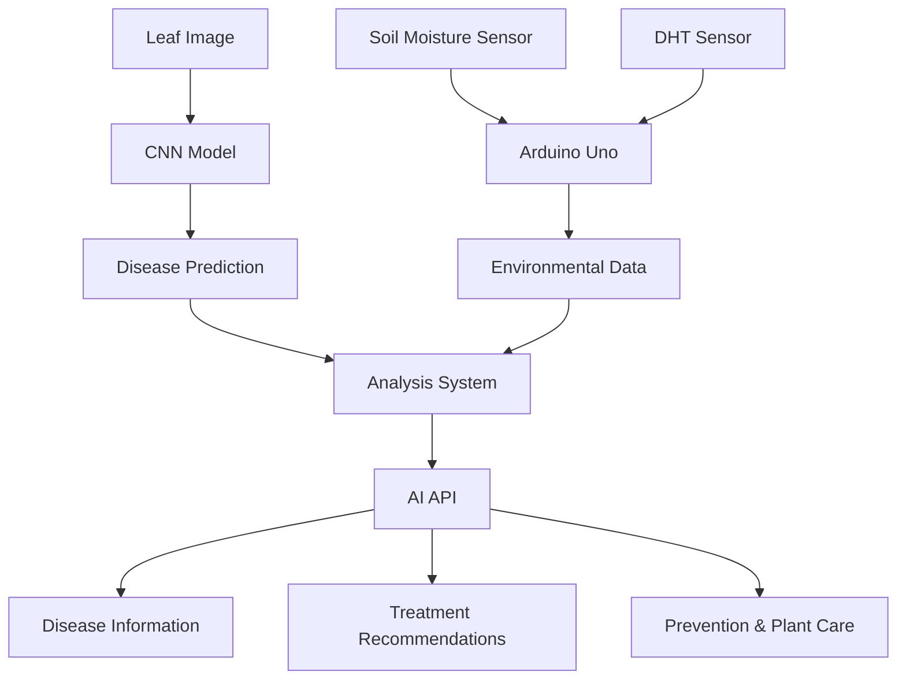
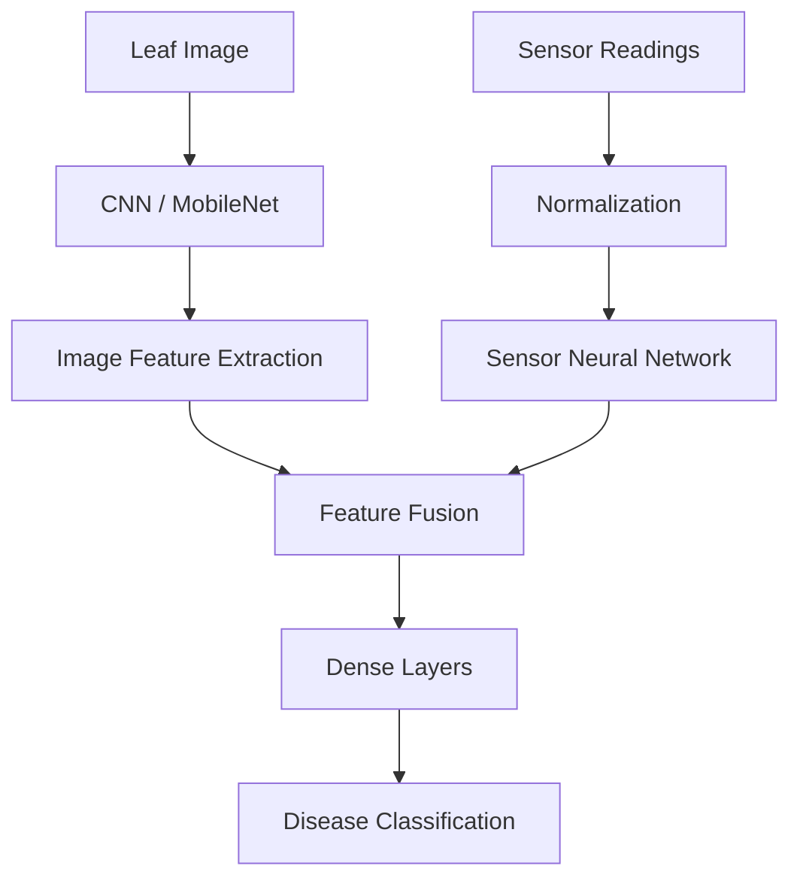

# 🌿 Plant Disease Detection Using CNN & IoT

An AI-powered plant disease detection system that combines **leaf image analysis, IoT-based environmental monitoring, and generative AI** to identify potential plant diseases and provide actionable treatment and prevention recommendations.

The system analyzes images of plant leaves using a Convolutional Neural Network (CNN), collects environmental data through Arduino-connected sensors, and uses AI to provide information about the detected disease, its causes, treatment, and preventive measures.

---

## 📌 Overview

Traditional plant disease detection relies heavily on manual inspection, which can be time-consuming and requires agricultural expertise.

Our project aims to make plant disease identification more accessible by integrating:

- 🖼️ **Computer Vision** — Detects disease patterns from leaf images.

- 🧠 **Deep Learning** — Uses a fine-tuned `MobileNetV2` CNN model trained on PlantVillage to classify **38 classes** (**26 disease/pest conditions** and **12 healthy classes**) across **14 crop species**.

- 🌡️ **IoT Monitoring** — Collects temperature, humidity, and soil moisture data.

- 🤖 **Generative AI** — Provides disease explanations, treatment suggestions, and precautions.

### Supported Crop Species & Detectable Diseases (38 Classes)

- **Apple (4 classes):** Healthy (`Apple___healthy`), Apple scab (`Apple___Apple_scab`), Black rot (`Apple___Black_rot`), Cedar apple rust (`Apple___Cedar_apple_rust`)

- **Blueberry (1 class):** Healthy (`Blueberry___healthy`)

- **Cherry including sour (2 classes):** Healthy (`Cherry_(including_sour)___healthy`), Powdery mildew (`Cherry_(including_sour)___Powdery_mildew`)

- **Corn / Maize (4 classes):** Healthy (`Corn_(maize)___healthy`), Cercospora leaf spot / Gray leaf spot (`Corn_(maize)___Cercospora_leaf_spot Gray_leaf_spot`), Common rust (`Corn_(maize)___Common_rust_`), Northern Leaf Blight (`Corn_(maize)___Northern_Leaf_Blight`)

- **Grape (4 classes):** Healthy (`Grape___healthy`), Black rot (`Grape___Black_rot`), Esca / Black Measles (`Grape___Esca_(Black_Measles)`), Leaf blight / Isariopsis Leaf Spot (`Grape___Leaf_blight_(Isariopsis_Leaf_Spot)`)

- **Orange (1 class):** Haunglongbing / Citrus greening (`Orange___Haunglongbing_(Citrus_greening)`)

- **Peach (2 classes):** Healthy (`Peach___healthy`), Bacterial spot (`Peach___Bacterial_spot`)

- **Pepper, bell (2 classes):** Healthy (`Pepper,_bell___healthy`), Bacterial spot (`Pepper,_bell___Bacterial_spot`)

- **Potato (3 classes):** Healthy (`Potato___healthy`), Early blight (`Potato___Early_blight`), Late blight (`Potato___Late_blight`)

- **Raspberry (1 class):** Healthy (`Raspberry___healthy`)

- **Soybean (1 class):** Healthy (`Soybean___healthy`)

- **Squash (1 class):** Powdery mildew (`Squash___Powdery_mildew`)

- **Strawberry (2 classes):** Healthy (`Strawberry___healthy`), Leaf scorch (`Strawberry___Leaf_scorch`)

- **Tomato (10 classes):** Healthy (`Tomato___healthy`), Bacterial spot (`Tomato___Bacterial_spot`), Early blight (`Tomato___Early_blight`), Late blight (`Tomato___Late_blight`), Leaf Mold (`Tomato___Leaf_Mold`), Septoria leaf spot (`Tomato___Septoria_leaf_spot`), Two-spotted spider mite (`Tomato___Spider_mites Two-spotted_spider_mite`), Target Spot (`Tomato___Target_Spot`), Tomato Yellow Leaf Curl Virus (`Tomato___Tomato_Yellow_Leaf_Curl_Virus`), Tomato mosaic virus (`Tomato___Tomato_mosaic_virus`)

The goal is to develop a smart plant health monitoring system that considers both **visual symptoms and environmental conditions**.
---

## ✨ Features

- 📷 Upload a plant leaf image for disease detection.
- 🧠 CNN-based plant disease classification.
- 🌱 Soil moisture monitoring using a soil moisture sensor.
- 🌡️ Temperature and humidity monitoring using a DHT sensor.
- 🔌 Arduino Uno-based sensor data acquisition.
- 📊 Environmental condition analysis.
- 🤖 AI-generated disease explanations.
- 💊 Treatment and prevention recommendations.
- 🌿 Plant care suggestions based on available information.

---

## 🏗️ System Architecture



### System Components

| Component | Role |
|---|---|
| Leaf Image | Input for visual disease analysis |
| CNN Model | Extracts visual features and classifies plant diseases |
| Arduino Uno | Collects and transmits sensor readings |
| Soil Moisture Sensor | Measures soil moisture levels |
| DHT Sensor | Measures surrounding temperature and relative humidity |
| AI API | Generates explanations and recommendations |
| Backend | Processes inputs and connects the different components |

---

## 🧠 Machine Learning Approach

### 1. Image-Based Disease Detection

The image classification model is trained on a plant disease image dataset containing approximately **54,000 preprocessed images**.

The CNN learns visual patterns such as:

- Leaf discoloration
- Spots and lesions
- Texture changes
- Damaged leaf areas
- Patterns associated with different diseases

### 2. Environmental Data

The IoT subsystem collects environmental readings:

| Parameter | Sensor |
|---|---|
| Soil Moisture | Soil moisture sensor |
| Air Temperature | DHT sensor |
| Relative Humidity | DHT sensor |

These readings provide additional environmental context that may be relevant to plant health and disease development.

### 3. Multimodal Integration

The planned advanced model will combine:

- CNN-extracted image features
- Numerical sensor features

These features can be combined using a **feature-fusion architecture** to produce a disease prediction based on both image and environmental inputs.

> Currently, the CNN serves as the primary image-based disease classifier, while sensor readings provide environmental context. A properly trained multimodal model will require paired image, sensor, and disease-label data.

---

## 🔬 Planned Model Architecture



The proposed multimodal architecture uses two separate branches:

- **Image branch:** CNN extracts disease-related visual features.
- **Sensor branch:** Neural network processes numerical environmental data.

The branches can later be combined through feature concatenation and dense layers.

---

## 📊 Dataset

- **Total Images:** ~54,000
- **Type:** Plant leaf images
- **Status:** Preprocessed
- **Purpose:** Training and evaluation of the disease classification model

The image dataset is used to train the CNN model.

Environmental sensor readings are not currently paired with the image dataset. Real-world paired data collection is planned for future multimodal model training and evaluation.

---

## 🛠️ Tech Stack

### Artificial Intelligence & Machine Learning

- Python
- TensorFlow / Keras
- CNN
- MobileNetV2 / EfficientNet *(candidate architectures)* 
- NumPy
- Pandas
- OpenCV
- Scikit-learn

### IoT & Hardware

- Arduino Uno
- Soil Moisture Sensor
- DHT11 / DHT22 Sensor

### Backend & AI Integration

- Python
- Flask / FastAPI *(planned backend)*
- Gemini API / LLM API *(AI-powered agricultural assistance)*

---

## 🔌 Hardware Components

| Hardware | Purpose |
|---|---|
| Arduino Uno | Microcontroller for sensor data collection |
| Soil Moisture Sensor | Monitors moisture in soil |
| DHT11 / DHT22 | Measures air temperature and humidity |
| Connecting Wires | Sensor connections |
| USB Cable | Arduino communication and power |

> The DHT sensor measures surrounding air temperature and humidity, not soil temperature.

---

## 🔄 Project Workflow

1. **Upload Leaf Image**  
   The user uploads an image of a plant leaf.

2. **Image Processing**  
   The image is resized and normalized according to the model's requirements.

3. **CNN Prediction**  
   The trained model analyzes the leaf image and predicts the disease class.

4. **Sensor Data Collection**  
   Arduino collects soil moisture, temperature, and humidity readings.

5. **Environmental Analysis**  
   The environmental readings are analyzed alongside the image-based prediction.

6. **AI Assistance**  
   The predicted disease and available environmental information are sent to an AI API.

7. **Result Generation**  
   The system presents disease information, possible causes, treatment suggestions, precautions, and plant-care recommendations.

---

## 📁 Project Structure

```text
Plant-Disease-Detection/
│
├── dataset/
│   └── plant_disease_images/
│
├── model/
│   ├── training/
│   ├── evaluation/
│   └── saved_model/
│
├── hardware/
│   ├── arduino_code/
│   └── circuit_diagram/
│
├── backend/
│   ├── app.py
│   ├── routes/
│   └── services/
│
├── frontend/
│
├── notebooks/
│   └── model_training.ipynb
│
├── requirements.txt
├── README.md
└── .gitignore
```

*The structure represents the planned organization of the project and may evolve during development.*

---

## 🚀 Development Roadmap

- [x] Collect plant disease image dataset
- [x] Preprocess image dataset
- [x] Finalize project concept and system design
- [ ] Analyze dataset classes and distribution
- [ ] Train baseline CNN model
- [ ] Evaluate model using accuracy, precision, recall, and F1-score
- [ ] Implement Arduino sensor acquisition
- [ ] Integrate soil moisture sensor
- [ ] Integrate temperature and humidity sensor
- [ ] Develop backend for model inference
- [ ] Integrate environmental analysis
- [ ] Integrate AI API for disease explanations and recommendations
- [ ] Build user interface
- [ ] Collect paired real-world sensor and image data
- [ ] Develop multimodal image + sensor fusion model
- [ ] Compare image-only model against multimodal model

---

## ⚠️ Limitations

- Image-based predictions depend on dataset quality and diversity.
- Similar diseases may produce visually similar symptoms.
- Sensor readings provide environmental context but do not independently confirm a plant disease.
- Environmental conditions alone cannot establish the presence of an infection.
- AI-generated treatment suggestions should be verified against reliable agricultural guidance.
- Actual sensor-based improvements in disease prediction require training and testing on properly paired real-world data.

---

## 🌱 Future Scope

- Multimodal deep learning for image and sensor fusion.
- Real-time plant health monitoring.
- Support for more plant species and disease classes.
- Disease severity estimation.
- Environmental risk assessment.
- Historical sensor data tracking.
- Smart irrigation recommendations.
- Mobile-friendly interface.
- IoT dashboard for continuous monitoring.
- Integration with reliable agricultural knowledge sources.

---

## 👥 Contributors

Khilesh Kumar @itskhilesh

---

## 💡 Project Vision

To build an intelligent plant health monitoring system that combines computer vision, environmental sensing, and AI-powered agricultural assistance to help users detect plant diseases and make informed plant-care decisions.

**Combining AI with IoT for smarter and more informed plant health monitoring. 🌿**

---

⭐ If you find this project interesting, consider giving it a star!
